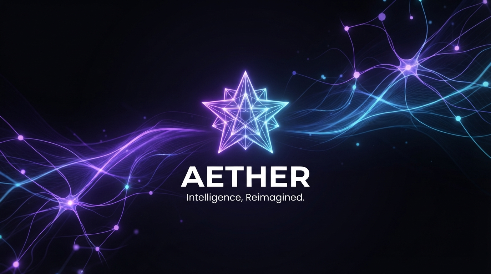
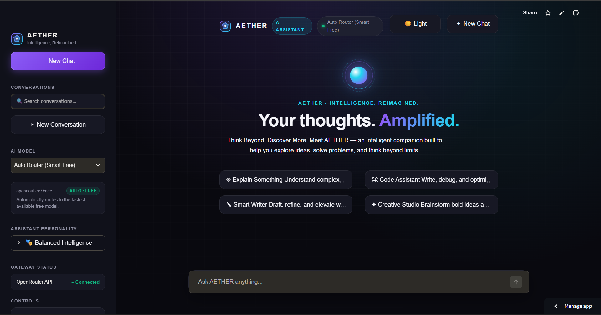
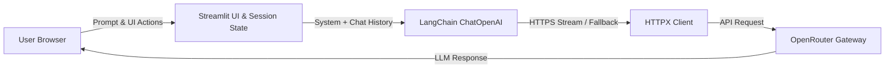

<div align="center">



# ✦ AETHER

**Intelligence, Reimagined — A Multi-Model AI Chatbot Web Application**

[](https://myfreeaichatbot.streamlit.app/)
[](https://www.python.org/)
[](https://www.langchain.com/)
[](https://openrouter.ai/)
[](LICENSE)

[Live Demo](https://myfreeaichatbot.streamlit.app/) · [Features](#-features) · [Interface](#-interface-showcase) · [Architecture](#%EF%B8%8F-architecture) · [Quick Start](#-quick-start) · [Documentation](docs/ARCHITECTURE.md)

</div>

---

## 📖 Overview

**AETHER** is a modern, multi-model AI assistant built with **Python**, **Streamlit**, **LangChain**, and the **OpenRouter API**. Engineered with a custom dual-theme interface, multi-session state management, and resilient hybrid token streaming, it transforms a lightweight Python stack into an intuitive conversational workspace.

---

## ✨ Features

* **🔀 Multi-Model AI Gateway** — Switch dynamically between free-tier models via OpenRouter (`openrouter/free`, `nvidia/nemotron-3.5-lightning:free`, and `nvidia/nemotron-3-ultra-550b-a55b:free`) without losing conversation context.
* **⚡ Resilient Hybrid Token Streaming** — Streams real-time responses token-by-token using LangChain and `httpx` (`st.write_stream`), with automatic fallback to standard requests when firewalls interrupt SSE streams.
* **🗂️ Multi-Session Conversation Workspace** — Persistent conversation history in `st.session_state` with automatic chat titling, live search, inline rename/delete controls, and two-step clear confirmation.
* **🎭 Customizable Assistant Personas** — Built-in system presets (*Balanced Intelligence*, *Senior Code Architect*, *Academic Mentor*, *Creative Strategist*) plus live custom system prompt editing.
* **🎨 Dual-Theme Design System** — Custom CSS variable theming supporting **Obsidian Dark** and **Clean Light** modes, glassmorphic starter cards, contextual follow-up suggestions, one-click clipboard copy, and response regeneration.

---

## 🖥️ Interface Showcase

<div align="center">
  
  <br />
  <sub><b>Obsidian Dark Mode</b> — Custom theme system, multi-session sidebar, and glassmorphic starter cards</sub>
</div>

---

## 🏗️ Architecture



* Technical architecture details: [docs/ARCHITECTURE.md](docs/ARCHITECTURE.md)
* Cloud deployment guide: [docs/DEPLOYMENT.md](docs/DEPLOYMENT.md)

---

## 🚀 Quick Start

1. **Clone the repository**
   ```bash
   git clone https://github.com/jayabrataray/ai-chatbot.git
   cd ai-chatbot
   ```
2. **Install dependencies**
   ```bash
   pip install -r requirements.txt
   ```
3. **Configure environment variables**
   ```bash
   cp .env.example .env
   # Add OPENROUTER_API_KEY=sk-or-v1-your-api-key-here inside .env
   ```
4. **Launch the application**
   ```bash
   streamlit run app.py
   ```

---

## ⚙️ Configuration

| Setting / Variable | Location | Description |
| :--- | :--- | :--- |
| `OPENROUTER_API_KEY` | `.env` (Local) or `st.secrets` (Cloud) | Authenticates requests to OpenRouter (`https://openrouter.ai/api/v1`). |
| `openrouter/free` | Sidebar -> AI Model | Auto-routes prompts to an available free model. |
| `nvidia/nemotron-3.5-lightning:free` | Sidebar -> AI Model | Optimized for fast, low-latency everyday responses. |
| `nvidia/nemotron-3-ultra-550b-a55b:free` | Sidebar -> AI Model | High-capacity reasoning and code generation model. |

---

## 📁 Project Structure

```text
ai-chatbot/
├── .github/workflows/ci.yml   # Automated syntax & unit test workflow
├── aether/                    # Modular configuration & utility helpers
│   ├── __init__.py
│   ├── config.py
│   └── utils.py
├── asset/                     # Banner and dual-theme UI screenshots
├── docs/                      # Architecture and deployment documentation
│   ├── ARCHITECTURE.md
│   └── DEPLOYMENT.md
├── tests/                     # Unit tests for core utilities
│   └── test_core.py
├── .env.example               # Safe environment variable template
├── .gitignore                 # Git ignore rules
├── app.py                     # Main Streamlit application entry point
├── CODE_OF_CONDUCT.md         # Community standards
├── CONTRIBUTING.md            # Contribution guidelines
├── LICENSE                    # MIT License
├── README.md                  # Project documentation
├── requirements.txt           # Python dependencies
└── SECURITY.md                # Credential & security policy
```

---

## 🎓 Acknowledgments

Developed by **Jayabrata Ray** (1st-Year BCA Student) as an iterative, hands-on exploration into LLM integration, state-driven web interfaces, and UI/UX engineering with AI-assisted development guidance.
